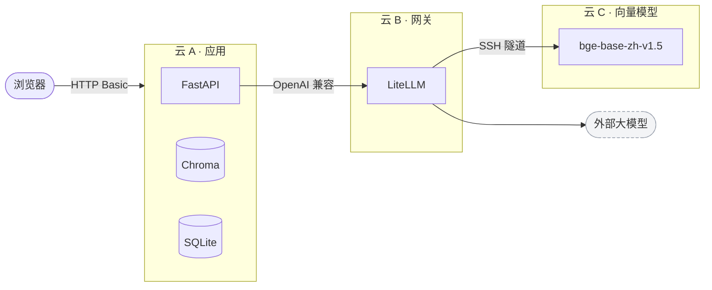

# 个人知识库问答系统

把自己的 PDF、Word、PPT、笔记和截图变成可提问的知识库：**先检索，再让大模型基于检索到的片段作答，并标注出处。**

基于 LangChain 组件构建，跑在三台 2 核小规格云主机上，不需要 GPU。

---

## 它解决什么问题

资料存了一堆，用的时候只记得「好像在哪看过」。直接把文档丢给大模型又受上下文长度和成本限制，
而且模型容易编造。

这套系统的做法是：把文档切成小块建立向量索引，提问时按语义召回最相关的几段，
再让模型**只依据这些片段**回答，每句结论都能点开看原文。

## 功能

| | |
|---|---|
| 多格式入库 | PDF / Word / PPT / Markdown / 纯文本 / 图片 |
| 图片识别 | 文档内嵌的截图、架构图经多模态模型识别后**插回原文位置**，一并可检索 |
| 多轮对话 | 追问时自动补全指代（「那它的上限呢」→ 补成完整问题再检索） |
| 来源可核对 | 回答中的 `[1]` 可点开，显示原文片段、来源文件、PDF 页码和相似度 |
| 自动分类 | 上传时模型建议分类，可手工覆盖，侧栏按分类分组 |
| 原文下载 | 随时取回当初上传的原始文件 |
| 全链路追踪 | 接入 LangSmith，每次提问的各环节耗时与输入输出自动记录 |

## 架构



向量模型自托管在独立主机（常驻约 800 MB，应用机放不下）；所有模型调用统一走 LiteLLM 网关，
换模型只改网关配置。详见 [`docs/architecture.md`](docs/architecture.md)。

## 快速开始

需要一个 OpenAI 兼容的模型网关（LiteLLM 配置样例见 [`litellm/config.yaml`](litellm/config.yaml)）。

```bash
cp .env.example .env
# 填入 LLM_BASE_URL、LLM_API_KEY、WEB_PASSWORD
docker compose up -d --build
```

打开 http://127.0.0.1:8765 ，用 `.env` 里的账号密码登录。
`sample_kb/` 下有两篇示例文档可以直接上传试用。

> `.env` 必须是 LF 换行且无 BOM；多余的 `\r` 会让容器里的每个值都悄悄出错。
> 另外改完 `.env` 要重建容器，`docker restart` 不会重新读取 `--env-file`。

### 本地跑测试

```bash
pip install -r requirements.txt
python -m unittest discover -s tests -t .
```

## 项目结构

```
app/
├── main.py            HTTP API 与鉴权
├── config.py          环境变量配置
├── clients.py         模型客户端（经网关）
├── conversations.py   多轮记忆（SQLite）
├── tracing.py         LangSmith 追踪
├── rag/
│   ├── chunking.py    切分
│   ├── embedding.py   向量化
│   ├── store.py       Chroma 读写
│   ├── retrieval.py   召回
│   └── answer.py      提示词与生成
└── ingest/
    ├── extract.py     文档解析
    └── vision.py      多模态 OCR
```

## 设计决策

**手写文档解析，而不是用现成 Loader。** 标准加载器会丢掉内嵌图片、演讲者备注、组合图形
和表格顺序，而这些是真实笔记里信息密度最高的部分。代价是解析逻辑要自己维护。

**固定「检索 → 生成」流程，没有做成 Agent。** 当前只有一个数据源，所有问题都是查资料，
没有路由的必要。固定流程更稳、更省，延迟也可预测。等接入订单查询这类需要**精确匹配**的
数据源时，才需要让模型决定走哪条路——那时 Agent 的作用是路由，不是让检索变聪明。

**片段 ID 按文件名生成，不按内容哈希。** 否则两个内容相同、文件名不同的文档会互相覆盖，
先上传的那份会静默消失（这个缺陷是写回归测试时发现的）。

**不默认下发 `reasoning_effort`。** 实测部分网关对该参数的处理是把思考内容并入正文，
导致回答开头出现大段英文推理。只在确认模型支持时才开启。

**相似度低于阈值的片段直接丢弃。** 否则打招呼这类闲聊也会召回一堆无关内容塞进上下文。

## 性能

通过 LangSmith 实测，单次提问的耗时构成：

| 环节 | 占比 |
|---|---|
| 问题改写 | 首轮跳过，多轮约 2 s |
| 向量化 + 检索 | < 10% |
| **模型生成** | **> 85%** |

结论：**瓶颈在模型，不在检索。** 把 `TOP_K` 从 8 调到 6 只能省不到 0.1 秒，
换掉会长时间「思考」的推理模型则让平均耗时从 33 s 降到 8 s。

向量检索本身对数据量不敏感——Chroma 用 HNSW 索引，实测 2 千条和 2 万条的检索耗时在同一量级。
真正的规模限制是内存：索引需常驻，2 GB 机器大约可容纳 5–10 万片段。

## 评测

两套评测集，方法与脚本见 [`eval/README.md`](eval/README.md)。

**公开可复现**——上传 `sample_kb/` 下 6 篇示例文档即可得到相同结果：

```bash
python eval/run_eval.py --user admin --password '...' \
  --judge-model kb-chat --judge-base-url http://127.0.0.1:4000/v1 --judge-api-key "$LLM_API_KEY"
```

| 指标 | 结果 |
|---|---|
| 召回命中率 | 100%（19 条） |
| 要点覆盖率 | 100%（19 条） |
| 拒答正确率 | 100%（2 条） |
| 首字 P50 / P95 | 2.2s / 14.8s |

> 这组数字只能算冒烟测试：示例语料仅 16 个片段，而 `TOP_K=8`，等于每次检索都返回了半个知识库，
> 召回率必然满分。它验证的是链路正确性，不是检索质量。

**真实语料**——51 份技术文档、4969 个片段，同一套脚本、20 条同样结构的题目（题目与语料未公开）：

| 指标 | 结果 |
|---|---|
| 召回命中率 | **89%**（18 条） |
| 要点覆盖率 | **79%**（18 条） |
| 拒答正确率 | **100%**（2 条） |
| 首字 P50 / P95 | 4.6s / 17.2s |

分类型来看：概念题 93%、事实题 78%、跨文档题 62%。

**两个失败案例恰好印证了下面「已知不足」里写的问题**：问到具体配置字段名和具体服务名时，
检索召回了主题相近但内容无关的文档——这正是纯向量检索对专有名词不敏感的典型表现，
也是优先级最高的改进项。

## 已知不足

- **未做重排序（rerank）。** 文档量增长后，不同文档中语义相近的片段会互相挤占 `TOP_K` 名额。
  后续计划粗召回 30 条再精排到 8 条。
- **纯向量检索，缺少关键词召回。** 对专有名词、配置字段名、型号、错误码这类精确匹配场景不理想
  ——真实语料评测中两例召回失败都属于这一类。混合检索（BM25 + 向量）会更稳。
- **跨文档综合能力偏弱。** 真实语料上 `multi_hop` 类题目要点覆盖率 62%，明显低于概念题的 93%。
- **入库是同步的。** 含大量图片的文件要逐张识别，上传请求会等待较久，没有后台任务队列。
- **图片识别结果缓存不随文档删除。** 删除文档会清掉片段和原文件，但 OCR 缓存仍保留。
- **仅 HTTP Basic 鉴权。** 单用户自用够了，公网暴露需要配 HTTPS 与访问限制。
- **没有自动备份。** 向量库和对话记录需要自行定期打包。

## 后续计划

- [x] 补齐评测集并跑出基线
- [ ] 加入重排序与混合检索，优先解决专有名词召回
- [ ] 用 LangGraph 重构为带只读运维工具（`docker ps` / `logs` / `stats`）的 Agent
- [ ] 接入 Langfuse 做自托管可观测，替代/并行 LangSmith

## 许可

MIT
