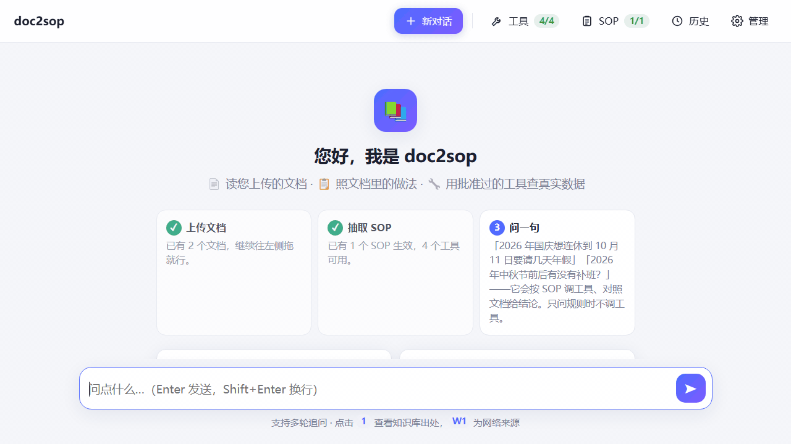
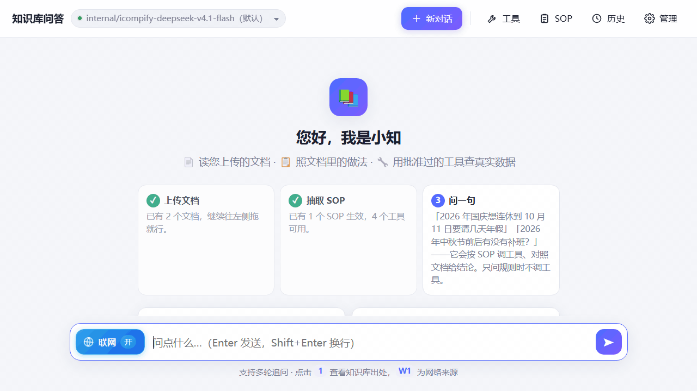

# doc2sop

**把团队文档变成 Agent 的 SOP，只用你批准过的只读工具查真实数据。**<br>
Turn your team's docs into agent SOPs — executed only with the read-only tools you approved.

[](LICENSE)


不限岗位：运维查容器、研发查模型网关、行政查节假日，换一批文档和工具就是换一个场景。单机 2 核 2 GB 可跑，不需要 GPU。



**照着 SOP 办事**：问一句，它按文档里的步骤查实际数据再下结论。



**SOP 从实践里长出来**：一次自由排查后，它提议沉淀成 SOP，人点一下保存。

## 快速开始

只要 Docker 和一把模型 key（推荐[硅基流动](https://cloud.siliconflow.cn)：同一把 key 同时有对话模型和向量模型）：

```bash
git clone https://github.com/wangyd1988/doc2sop.git && cd doc2sop
cp .env.example .env        # 只改两处：WEB_PASSWORD（登录密码）、LLM_API_KEY（你的 key）
docker compose up -d --build
# 打开 http://127.0.0.1:8765 ，用户名 admin。几十秒后两个演示场景包导入完成，点示例问题就能看到上面两段效果
```

> 国内网络 `up` 卡在拉取 `python:3.12-slim`？`.env` 里打开 `BASE_IMAGE=docker.m.daocloud.io/library/python:3.12-slim` 那一行，再 `up` 一次。

精确到点哪里、问什么、预期看到什么：[`docs/五分钟演示.md`](docs/五分钟演示.md)。

## 它和你见过的工具有什么不同

| 你可能用过 | 它们做什么 | doc2sop 不一样的地方 |
|---|---|---|
| 知识库产品：Dify / FastGPT / MaxKB | 回答「文档上怎么说」 | 还会照文档里的步骤去查真实数据，对照后给结论 |
| 运维 Agent：HolmesGPT / k8sgpt | 能查系统，但 runbook 要人手写，只服务运维 | SOP 从文档自动抽取、也能从一次排查里长出来；行政、研发、运维都是换一批文档和工具 |
| 通用 Agent 框架 | 给了执行权限就收不回来 | Agent 只能提交「工具名 + 参数」；工具只读、由宿主机管理员定义并审批；SOP 只能引用已有工具 |

## 知识库 → SOP → 工具

```
📄 知识库（文档）          📋 SOP（步骤）              🔧 工具（执行）
《休假管理制度》         →  1. 查当年节假日     ───────→  holiday_calendar
  先查节假日和补班、         2. 逐日确认星期几   ───────→  date_info
  再逐日看是不是工作日……     3. 算要请几天
  人看的文字                 自动抽取、页面可调           管理员审过的只读能力
```

| | 来源 | 回答什么 | 谁能改 |
|---|---|---|---|
| 知识库 | 你上传的文档 | 规定是什么、应该怎么做 | 任何能上传文档的人 |
| SOP | 从文档自动抽取，或从一次自由排查沉淀 | 按什么顺序、调哪个工具、每步看什么 | 页面可编辑、启停；沉淀的要人批准才保存 |
| 工具 | 宿主机配置 | 实际执行哪条命令、调哪个接口 | 只有宿主机管理员 |

**SOP 只能引用已有工具，不能定义新命令，所以文档被投毒也变不成执行能力。** Agent 拿不到 shell，也拿不到任何凭据：
它只能提交工具名和结构化参数，由宿主机上只监听 `127.0.0.1` 的只读接口按固定模板执行。安全约定的全部细节见 [`docs/工具.md`](docs/工具.md)。
现成的 MCP server 也能接进来，但每个工具都要在宿主机上逐个批准、确认只读后才给模型，见 [`docs/工具.md` 的 MCP 小节](docs/工具.md#mcp-工具接现成的-mcp-server但每个工具都要你批准)。

## 场景包

一个场景包 = 文档 + 工具定义 + SOP 放在同一个目录里，拿走就用、改了就能贡献。仓库自带三个：

| 目录 | 谁用 | 知识库里放 | 工具查什么 | 一句话提问 |
|---|---|---|---|---|
| [`packs/leave-planning`](packs/leave-planning/) | 行政 / 人事 / 全员 | 《休假管理制度》 | 法定节假日与补班、日期是星期几 | 「国庆想连休到 10 月 11 日要请几天年假」 |
| [`packs/model-selfcheck`](packs/model-selfcheck/) | 研发 / 任何调模型的人 | 《模型服务自查手册》 | 这把 key 能用哪些模型、余额与状态 | 「我这把 key 能用哪些模型？余额还剩多少？」 |
| [`packs/ops-inspection`](packs/ops-inspection/) | 运维 | 《日常巡检规范》 | 磁盘、内存、负载、容器状态 | 「帮我做一次日常巡检」（需宿主机 docker） |

前两个不需要任何基础设施，是快速开始里自动导入的内容。目录格式、导入发生了什么、怎么贡献一个包：[`docs/场景包.md`](docs/场景包.md)。

## 它怎么工作

一次提问走四步，以第一张 GIF 为例：

```
用户：国庆想连休到 10 月 11 日要请几天年假

  ① 检索知识库    → 《休假管理制度》：补班日虽在周末也计入请假天数；命中 SOP《请假拼假核对》
  ② 按 SOP 调工具  → holiday_calendar(下一个国庆所在的年份) → date_info(10-08 … 10-11)
  ③ 对照          → 节日放假到哪天、前后哪个周末要补班；补班日虽是周六日，也算工作日
  ④ 给出结论      → 请 N 天、具体哪几天（凭直觉漏掉补班日就会少算一天）；表格列出每步看了什么、实际数据、判断
```

只问规则的问题不调工具，延迟和纯 RAG 一样。模型 ⇄ 工具的循环由 LangGraph 驱动，检查点记住整轮过程，追问能直接用上一轮查到的原始数据。

每一轮提问都记进**组织运行图谱**（`data/graph.db`，一个 SQLite 文件）：工具的完整返回（不是页面上的预览）、按哪个 SOP 跑的、
结论质量；容器、命名空间、SOP、文档、阈值自动成为实体，事实带出处、只追加不覆盖。「从实践里长出 SOP」就建在它上面——
回答结束后，后台把本轮轨迹整理成 SOP 提议，证据指向具体某次工具调用，人批准才保存；下面 Roadmap 里的漂移检测、可审计记忆也都从这里长。
链路细节见 [`docs/architecture.md`](docs/architecture.md)。

## 功能

- **多格式入库**：PDF / Word / PPT / Markdown / 纯文本 / 图片，后台入库显示进度；文档内嵌的截图、架构图识别后插回原位，一并可检索。
- **混合检索 + 重排**：向量 + BM25 两路召回、RRF 融合，交叉编码器精排；回答里的 `[1]` 可点开看原文、来源文件、页码和分数。打开 `KB_TOOLS` 后模型还能自己换说法补查、读片段的前后文。
- **多轮记忆**：追问自动补全指代；LangGraph 检查点记住工具与搜索的原始返回，追问不必重查。
- **只读工具**：命令 / 脚本 / HTTP 接口三种，Agent 自行判断要不要查并与知识库对照；新增工具走宿主机审批，改完不用重启。可选的计算沙箱让模型写 Python 算准统计、比对：只读本轮查到的数据，在无网络的一次性 gVisor 容器里跑。[`docs/工具.md`](docs/工具.md)
- **SOP**：从文档自动抽取，每步附原句供核对；页面编排启停、一键「▶ 执行」；一次自由排查后可沉淀为 SOP。文档怎么写才抽得准：[`docs/SOP文档写法.md`](docs/SOP文档写法.md)
- **联网补充**：知识库答不了时经网关搜索，IP、密钥、内网域名在代码层拦截不外发；搜到的答案经人确认可存回知识库。
- **选模型**：顶栏切换这把 key 有权用的模型；管理页改网关地址、key（只写不读）、对话 / 向量 / 图片模型，保存即生效。
- **可观测与备份**：LangSmith 全链路追踪；`deploy/backup.sh` 每日打包 SQLite、向量库、原件、工具配置。
- 另有自动分类、原文下载、工具管理页、`POST /api/feedback` 对回答打「正确 / 误报 / 阈值不对 / 漏了步骤」。

每一项怎么做的、实测数字、设计决策、已知不足：[`docs/设计与取舍.md`](docs/设计与取舍.md)。

## 正式部署

一键演示是单机 compose 形态：应用容器 + 一个 128 MB 的只读工具 sidecar。正式用时应用跑 host 网络、工具服务和网关都在宿主机 `127.0.0.1` 上，
用 `deploy/release.sh` 发版：依赖预烘焙成 base 镜像、每次只 COPY 代码；停旧起新后**比对切换前后片段总数**，不一致自动回滚。
宿主机布局、首次安装、升级（`git pull && bash deploy/release.sh`）、回滚、备份 cron、内存看护：[`docs/正式部署.md`](docs/正式部署.md)。

- **工具跑在宿主机上**（查容器、K8s、内网接口）：宿主机部署 `deploy/ops_readonly.py`，`OPS_URL` 指向它，场景包的工具用一行 `include` 启用；`OPS_URL` 留空则退化为纯知识库问答。
- **模型可以在页面上填**：`.env` 里模型项留空也能启动，到「管理 → 模型设置」填，保存即生效。页面上填的 key 不会传给工具服务——工具凭据永远不经过页面，要用「模型网关」组的工具就把地址和 key 写进工具服务的环境。
- 联网搜索依赖 LiteLLM 网关的 `/v1/search`，直连厂商时不可用；网关样例见 [`litellm/config.yaml`](litellm/config.yaml)。
- 部署拓扑（应用 / 网关 / 自托管向量与重排模型）、问答与入库链路、代码结构：[`docs/architecture.md`](docs/architecture.md)。

本地跑测试：`pip install -r requirements.txt && python -m unittest discover -s tests -t .`

## Roadmap

方向：从「文档 → SOP → 工具」的单向流，演进为以**组织运行图谱**为中心——文档、工具返回、人工纠正都是输入，SOP 和文档都是生成物。

已做：

- [x] 图谱落盘：每次执行的工具完整返回、实体、带出处的事实
- [x] 自由排查长出 SOP：提议 → 人批准 → 默认停用的 SOP
- [x] 场景包：文档 + 工具 + SOP 一个目录，拿走就用
- [x] 一键演示：`docker compose up` 自动导入两个场景包
- [x] 工具层接 MCP server（第 1 期：stdio 客户端 + 逐个审批与只读确认）；doc2sop 自己作为 MCP server：`/mcp` 对外开放知识库、SOP（工具、提示词、`SKILL.md`）和宿主机标了 `export` 的只读工具，按客户端发令牌、审计、限流（`MCP_ENABLED`，默认关，见 [`docs/工具.md`](docs/工具.md#对外-mcp-出口让-claude-codecopilotcursor-用上知识库和-sop)）；知识检索工具化：`kb_search` / `kb_read` / `kb_catalog` 补查与读前后文、三种检索模式、待办清单 `plan`（默认关，评测达标后再定默认）；计算沙箱 `python_exec`：模型写 Python 算本轮数据工具的完整返回，宿主机沙箱服务起一次性 gVisor 容器（无网络、只读、限资源），输出照样算出网污点（`SANDBOX_URL`，默认空，见 [`docs/正式部署.md`](docs/正式部署.md#计算沙箱python_exec)）；远程主机：经 SSH 巡检一批 Linux 主机，`target` 参数与 `@组` 并发，受控模式（主机上的执行器 + root 所有的白名单 + 强制命令公钥）与直连模式，`enroll` / `push` / `status`，不配主机清单时一切照旧（见 [`docs/工具.md`](docs/工具.md#远程主机在别的-linux-主机上跑命令型工具)；演示站带一台演示主机）

计划（顺序大致如此，不承诺时间）：

- [ ] MCP 第 2、3 期与更多数据源：Streamable HTTP 传输、真实第三方场景包；SQL 模板、K8s / Prometheus 接口模板，场景包的工具可以换实现
- [ ] 触发式 SOP：cron / 告警 webhook → 执行 → 结论推企微 / 飞书 / 钉钉
- [ ] 按角色生成执行报告
- [ ] 文档漂移检测：文档说 900MB、现实连续三周 12MB → 提议改文档
- [ ] 可审计的记忆：阈值调整、误报纠正只能变成提议，人批准才生效
- [ ] 多账号与审计日志：接统一登录，工具按调用人身份取凭据，按岗位分配工具组与 SOP；复杂网络（网段里的 runner、跳板机）与 Windows 主机（WinRM + JEA）
- [ ] 自托管可观测：LiteLLM 网关侧开 Langfuse 回调
- [ ] 英文文档

## 许可

[MIT](LICENSE)
