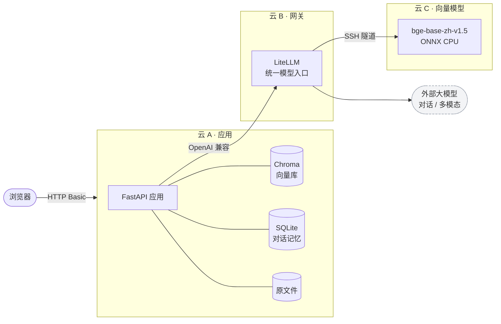

# 架构说明

## 部署拓扑

三台 2 核小规格云主机，按职责拆分。云 A 与云 C 之间网络不通，
所有跨区流量经由云 B 中转。



## 为什么这样拆

| 决策 | 原因 |
|---|---|
| 向量模型独立一台 | 模型常驻约 800 MB，应用机只有 2 GB，放一起会互相挤占 |
| 所有模型调用走 LiteLLM | 换模型、换供应商只改网关配置，应用代码不动 |
| 跨主机走 SSH 隧道 | 向量服务只监听 `127.0.0.1`，不暴露公网；密钥限制为仅允许单端口转发 |
| 向量库和原文件留在应用机 | 文档和索引不出自己的服务器，只有待识别图片和检索片段会发给模型 |

## 单机演示拓扑（compose `demo` profile）

上面是生产拓扑；给陌生人五分钟跑通用的是同一份代码的单机形态（`docs/五分钟演示.md`）：

```mermaid
flowchart LR
    U([浏览器]) -->|127.0.0.1:8765| APP
    subgraph H["一台机器 · docker compose"]
        APP[kb-app<br/>应用 · 900 MB]
        OPS[kb-ops<br/>ops_readonly.py · 128 MB<br/>端口不发布]
        HOST[kb-host<br/>演示主机 · sshd + ops_exec.py<br/>64 MB · 端口不发布]
        PK[(packs/<br/>场景包)]
        APP -->|OPS_URL + 令牌| OPS
        OPS -->|SSH 受控模式<br/>磁盘 / 内存 / 负载| HOST
        OPS -. include tools.yaml .-> PK
        APP -. 导入 docs/ 与 sops.json .-> PK
    end
    V([模型服务商<br/>对话 + 向量，一把 key]):::ext
    CDN([节假日数据 CDN]):::ext
    APP -->|OpenAI 兼容| V
    OPS -->|/v1/models /v1/user/info| V
    OPS --> CDN
    classDef ext fill:#f3f4f6,stroke:#9ca3af,stroke-dasharray:4 3
```

- 没有网关、没有自托管模型：对话和向量都走一家 OpenAI 兼容服务商（推荐硅基流动，一把 key）。
- 工具不是另一套实现：sidecar 跑的就是宿主机上那个 `ops_readonly.py`，只是工具定义通过 `include:` 来自场景包，
  凭据（`OPS_TOKEN`、`OPS_SECRET_GATEWAY_*`）由 compose 从同一个 `.env` 映射进去，页面依旧碰不到。
- 多机巡检：sidecar 自己算本机，演示主机 kb-host 经 SSH 受控模式巡检，两台合成分组 `demo`。演示主机不挂 docker.sock，
  白名单只有磁盘、内存、负载三个工具；两边只经一个卷交换公钥，私钥不出各自的容器。
- 应用启动后在后台导入 `DEMO_PACKS` 列出的场景包：文档走入库链路，SOP 走 `playbooks.validate`——和手工操作完全相同的两条路径。

## 问答链路

```
提问
 └─ 问题改写      多轮时补全指代，首轮直接跳过
 └─ 向量化        云 A → 云 B → 云 C
 └─ 混合检索      向量 + 关键词融合、低分过滤、重排，取 TOP_K
 └─ 生成回答      系统提示 + 历史 + 片段，流式返回；有工具可绑时走 Agent（模型 ⇄ 工具循环）
 └─ 写入记忆      答案与引用一起存库
```

每一步都是 LangSmith 里的一个节点，耗时自动拆分。

**知识检索工具化（`KB_TOOLS`，默认关）。** 打开后知识库检索也是工具：`kb_search`（复用上面的混合检索，可按分类、文档过滤）、
`kb_read`（按片段 id「文档键:序号」读前后各几段，或按文档 + 页码读整页，拼接时去掉切分留的重叠）、`kb_catalog`（目录）。
没有工具服务、也没开联网的部署也会因此走 Agent 分支。`KB_RETRIEVAL_MODE` 决定首轮：`prefetch` 照上面先检索一次、不够时模型补查；
`forced` 不预检索，第一轮强制调 `kb_search`（模型不支持 `tool_choice` 时当场退回 `prefetch`）；`agentic` 全由模型决定。
补查的片段接着预检索的 `[1]…[k]` 编号，经 `kb_sources` 事件追加卡片、随回答落库；结构化结果放在工具消息的 `artifact` 里，
往后几轮回放只给文档名。知识类、流程类工具绑上时一轮最多 8 次工具调用（只有数据类、外网类时仍是 4 次）。

**知识库模式与智能模式（`SMART_MODE`，默认关）。** 页面输入框上方两个 tab，请求里是 `answer_mode`，每条消息记下当时的模式。
知识库模式就是上面这套。智能模式要 `KB_TOOLS`：不预检索、查不查由模型决定，资料不足时可以用模型自身的通用知识补充并标 `[💡]`，
本组织的规定、流程、内部系统必须先查知识库。提示词共用一套，智能模式只换掉「回答依据」那几句；「▶ 执行」沿用知识库模式的规则。
标了 `[💡]` 的内容不进 SOP 沉淀。详见 `docs/工具.md`「知识库模式与智能模式」。

**待办清单（`PLAN_TOOL`，默认关）。** 流程类工具 `plan`：模型维护整张清单（每次整体替换），经 `plan` 事件画成勾选列表；
点「▶ 执行」时代码先按 SOP 步骤预填。流程类调用不算观察到系统、不进 SOP、不记进图谱。

**联网与出网规则。** 联网打开时绑 `web_search`，再打开 `WEB_FETCH` 时多绑 `web_fetch`（读本轮搜索结果或用户给的链接的正文，
作为 `[W]` 来源接着编号）。出网通道——搜索词、链接、外部数据类工具（公网接口、远程 MCP server）的字符串参数——发出去之前都过
`egress.py` 的同一套规则：静态拦截、本轮数据类调用和沙箱输出留下的污点、链接来源、可选的严格模式（`WEB_AFTER_DATA=deny`），
见 `docs/工具.md`「出网规则」「外部工具」。外部工具的返回给模型看时标成外部资料，不算污点。

**计算沙箱（`SANDBOX_URL`，默认空）。** 配了才绑计算类工具 `python_exec`：模型写一段 Python，应用把它和本轮数据类调用的
**完整返回**（图谱里存的那一份，不是给模型看的压缩版）一起发给宿主机上的沙箱服务（`deploy/sandbox/`，`127.0.0.1:8797`，令牌），
沙箱服务起一个用完即弃的 gVisor 容器：无网络、只读、nobody、256MB、20 秒，数据只读挂在 `/data`。工具说明每次调模型前现算，
列出本轮此刻有哪些数据文件。应用依旧不挂 `docker.sock`，起容器的权限只在沙箱服务手里。计算类记进图谱，不算观察到系统、不进 SOP、不对外。

## 对外 MCP 出口（`MCP_ENABLED`，默认关）

```
外部智能体（Claude Code、Copilot、Cursor…）
 │  Streamable HTTP + 令牌（Authorization: Bearer）；生产上前面放反向代理和 TLS
 ▼
/mcp  TokenGate：先看来源地址（MCP_CLIENTS）· 页面上的总开关（关着一律 403，不碰令牌库）· 只认令牌（不认 Basic）· 按令牌限流、限会话数 → 官方 MCP SDK 的会话管理器
 │  工具：知识类 kb_* / sop_*、宿主机标了 export 的数据工具（照样转给工具服务 /exec，带 X-Ops-Caller）
 │  提示词：每个启用的 SOP 一条；变了发 list_changed
 ▼
工具注册表（和项目 Agent 读同一张表、调同一个实现）
```

项目页面和对外出口是同一个注册表的两个出口，权限看「类别 × 出口」：外网（`web_search`、`web_fetch`）、计算、流程类不对外，
所以对外出口不经过出网规则。令牌在管理页「对外接入」签发，只存哈希；每次调用审计（access.db）、记进图谱（`channel=mcp`）。
详见 [`工具.md`](工具.md) 的「对外 MCP 出口」。

## 云上协同（`CHAT_BRIDGE_URL`，默认关）

```
群成员 @ 机器人、私聊                          计划、告警规则的执行结果；每周缺口摘要
 │                                                ▲
 ▼                                                │ POST /push（只能按 targets.yaml 里的名字）
云上协同服务器 ── MQTT（TLS）──▶ doc2sop-ccwork 转接程序（宿主机 systemd，127.0.0.1:8796，令牌）
                ◀── HTTPS 发文字、流式包 ──┘  解密前限 64 KB、protobuf 限长度和嵌套、按发送人和会话限速、内存队列
                                               ▲ GET /events 长轮询（落库后下一次轮询才确认）· POST /reply（只能拿 handle）
                                               │
kb-app 聊天线程（chat_channel）── 白名单（chat.yaml）→ 收件表（chat_inbox）→ 暂停、限频、排队 → 命令或问题
                                   └─ 问题、「执行」：main.start_chat_turn / turn_events（和 /api/ask 同一个公共核心）
                                      渠道 chat；只绑这个群开通的数据工具（第二道：执行前再按名单核一遍）、只查开通的文档分类；
                                      系统提示词末尾多一段「回答会发到群里」；事件流在聊天线程里关掉，收尾照常
```

- **转接程序只搬运**：不懂谁能用、能查什么，从不自己回话；kb-app 拿不到原始会话 ID 去发消息（回复用 handle、推送用名字）。
  本地接口和平台无关，以后接别的聊天工具只要再写一个说同样接口的转接程序。
- **对话对应**：每个人在每个群一条对话（`chat_threads`），30 分钟没说话或回「新话题」就另开；接着用之前核对对话的最后一条消息还是记下的那条，
  对不上就另开。群聊的对话在网页上只读（`/api/ask` 回 409），对话列表按来源筛选。
- **回复**：流式 cover 包带到目前为止的全文，间隔 1.5 → 3 → 6 秒、每次回答最多 40 包；seq 只在成功后加，结果不明时同一包重发，
  平台明确拒了才换成普通文字发一次（这时真 @）。转成纯文本（SOP 的逐步表格一步一行）、只列引用了的出处、超过 3000 字截断，剩下的回「全文」。
  一次回答大约 3 分钟（按 SOP 执行大约 10 分钟）还没答完就不再等，回「没答出来」：只在两个事件之间看时间，模型单次调用最长 2 分钟、
  失败重试一次，最坏会超出一两分钟。
- **至多一次**：重启时「处理中」的记成中断、回一句「请再问一次」，不重跑；10 分钟内「已收到」的接着处理。
- **推送**：`autorun` 发完邮件后调 `chat_push.after_run`，规则沿用 `notify.decide`，设置和状态在旁表 `chat_notify`。

`chat.db` 里多了几张表，功能打开才建、老表一列没改：`chat_threads`、`chat_turns`（每条对话里的每一次执行：以后清理只按群聊来源删）、
`chat_inbox`、`chat_unknown`（没开通的只记 ID 和次数）、`chat_notify`、`chat_push_log`、`chat_state`。图谱的渠道多一个 `chat`，
执行记录的触发方式多一个 `chat`（「💬 群聊」）；旧版本读到不认识的值原样显示。部署见 [`正式部署.md`](正式部署.md#云上协同群聊机器人)。

## 组织运行图谱（graph.db）

文档 → SOP → 工具 原本是一条单向流，工具查到的真实数据和人对一次回答的判断答完就丢。
图谱把它们留下来，SOP 和文档从「源头」变成图谱的「生成物」；模块在 `app/graph.py`，
一个 SQLite 文件、六张表，不引入图数据库：

| 表 | 存什么 |
|---|---|
| `executions` | 一次提问 / 一次「▶ 执行」：会话、对应的回答消息、按哪个 SOP 跑的、结论质量（ok / anomaly / failed / unknown）；`channel` 是 web 或 mcp（对外 MCP 的一个会话一条，不算结论质量），自动执行的是 schedule / alert（「立即执行一次」也是 web） |
| `tool_calls` | 每次工具调用的参数、**完整返回**（页面和模型看到的都是截断 / 压缩过的）、成功与否、耗时 |
| `entities` | 容器、命名空间、K8s 对象、工具、SOP、文档、阈值、执行……`(kind, name)` 唯一，记首次 / 最近见到的时间 |
| `facts` | 主语 → 谓语 → 宾语（实体或字面量），带 `source_kind`（tool / doc / human / sop）和 `source_ref`（`tool_call:<id>` / `sop:<id>` / `feedback:<id>`） |
| `proposals` | 图谱提出的建议（长出 SOP、补充 SOP、调阈值……），`evidence_refs` 指向工具调用，状态 pending / approved / rejected |
| `feedback` | 人对一次执行的判断：correct / false_alarm / wrong_threshold / missing_step；对话里的「👎」是 unhelpful |

两条铁律：**没有出处的事实、没有证据的提议不进图谱**（Python 层校验 + 表上 CHECK）；
**事实只追加不覆盖**，同一主语同一谓语的多条记录就是时间线，撤回只把状态改成 retracted。

第一期不用模型抽实体，只在三处零成本播种：

```
保存 SOP      sop —checks→ tool；sop —defined_in→ doc；检查点里可靠解析出的「80%」「3 次」→ threshold 实体
调用工具      execution —called→ tool；调用成功时，工具声明了 x-entity 的实参成为实体并刷新 last_seen
             （老写法由工具服务按 name / k8s_name 预置正则推出，见 docs/工具.md「工具契约」）
人工反馈      execution —judged→ verdict（按 SOP 执行的，SOP 也记一笔）
```

工具调用在 `loop.py` 的 `tools` 节点里落盘（`run(..., execution_id=)`），对外事件仍只发预览，
前端协议不变；`/api/ask` 首行多一个 `execution_id`，`POST /api/feedback` 用它打反馈。

## 自由排查 → 长出 SOP

文档抽取是「人写过的做法 → SOP」；这条链路是「Agent 刚做过的事 → SOP」。模块在 `app/agent/grow.py`，
回答落库后在后台单线程里跑，不拖慢流式回答：

```
回答结束
 └─ 该不该提      自动提议开着 ∧ 当日未达上限 ∧ 不是「▶ 执行」∧ outcome ∈ {ok, anomaly}
                 ∧ ≥2 个不同数据类工具（联网搜索这类不算）∧ 回答有结论（≥40 字且开头不是「没查到 / 请提供…」；
                   智能模式标了 [💡] 的通用知识先整行去掉再判断，也不喂给下一步的模型）
                 ∧ 没套用启用中的 SOP（回答未写「按 SOP《」、工具序列也不按顺序覆盖某个 SOP 的步骤）
                 ∧ 同样的轨迹签名 30 天内没被忽略、也没有待确认的提议
 └─ 生成          把本轮轨迹（问题 + 第 n 次调用 xxx 的参数与返回摘要 + 结论）喂给模型，
                 复用文档抽取的 JSON 形状：具体对象泛化为空参数，checkpoint 写实际判断依据，
                 evidence 写「第 n 次调用 xxx 的返回：…」——序号、工具名对不上的加 ⚠ 留给人看
 └─ 门禁          猜错的参数键丢掉；过 playbooks.validate：只能引用已有工具，否则整条丢弃
 └─ 去重          候选步骤序列与某个已有 SOP（含停用）相似度 ≥ 0.7 → 改提「补充到《X》」，只带 X 没有的步骤；
                 X 已全覆盖则不提
 └─ 入 proposals  evidence_refs 指向本轮的 tool_call，signature 是工具序列签名
```

页面在回答结束后按 2/4/8…s 退避轮询 `GET /api/proposals?execution_id=`，拿到就在回答末尾画卡片；
SOP 面板顶部有「待确认提议 N」，回放对话时卡片也会补画。批准（`POST /api/proposals/{id}/approve`）
新建来源为「从实践沉淀」、默认停用的 SOP，或把步骤追加到目标 SOP 末尾；忽略则同签名 30 天静默。
开关 `AUTO_SOP_PROPOSALS`，每日上限 `SOP_PROPOSALS_PER_DAY`。

## 自动执行与执行记录

SOP 不只在有人问的时候跑（用法见 [`自动执行.md`](自动执行.md)）。四个入口最后都是同一种执行，结果都落成一条执行记录：

```
对话里「▶ 执行」   /api/ask 照旧流式回答；有 playbook_id 时多建一条记录（id = execution_id），回答结束时补上结论
立即执行一次 ┐
定时计划到点 ├─ autorun.enqueue → 线程池（同时 2 个、排队 10 个；同一 SOP 没跑完就不再起）
告警对上规则 ┘    └─ execute：和「▶ 执行」同一套 Agent 参数（知识库模式、默认模型、不联网），没有对话历史，
                    一次性的 Agent 线程跑完就删；告警内容标成外部资料附在提问后面
结束            runs.finish：从回答里按 SOP 输出格式解析逐步结论 → 等级、异常项；工具调用照常在图谱的 tool_calls 里
                 └─ notify.after_run（计划、规则选了收件组时）：按「什么时候发 / 同一个问题怎么提醒」决定发不发 → mailer
```

定时：`schedules` 的后台线程每 20 秒看一遍（`SCHEDULER`，默认开），时刻按北京时间（固定 UTC+8）算、库里存 UTC；
每个计划时刻先在 `sop_slots` 里占一行（主键冲突的不执行），发版切换时新旧两份同时在跑也只执行一次。迟到 10 分钟以内照常，
更晚的记一条「错过」、不补跑。告警：`/api/alerts/hook` 是挂在路由表上的 ASGI 端点，不经 FastAPI 的 Basic 依赖，
只认配好的告警令牌；没有令牌时回 404。邮件、收件组、告警令牌在页面上填（`automation_page`：扩大能力的请工具服务
`/tools/approval/verify` 核对审批口令，由应用写 `DATA_DIR` 下的 `automation.page.json` 和只写不读的 `automation.page-secrets.json`），
或手写在 `AUTOMATION_FILE`（默认 `DATA_DIR/automation.yaml`，写了的键以它为准）；三个文件按 inode、修改时间、大小热加载，合并成一份设置。

同一个 `graph.db` 里多了九张表（`CREATE TABLE IF NOT EXISTS`，老表一列没改，回滚到旧版本时旧代码不碰它们）：

| 表 | 存什么 |
|---|---|
| `sop_runs` | 执行记录：触发方式（web / schedule / alert / chat）、来源（计划 / 规则 id）、参数、SOP 当时的步骤、状态、等级、异常项、摘要、邮件结果 |
| `sop_schedules` | 定时计划：SOP、方式（daily / weekly / interval）、时刻、参数、收件组与提醒设置、上一个处理过的时刻 |
| `sop_slots` | 占过的计划时刻（计划 id + 时刻是主键），防重复执行 |
| `alert_rules` / `alert_events` | 告警规则；收到的每条告警对上了哪条规则、结果（保留 7 天） |
| `kb_gaps` / `kb_gap_ignores` | 知识库缺口：从回答和反馈里扫出来的问题、线索、向量；忽略过的代表问题 |
| `app_state` | 小的键值：知识库缺口扫描到哪了 |
| `automation_changes` | 页面上改自动执行设置的记录：时间、用户、来源地址、改了什么（不记授权码和令牌），留最近 200 条 |

## 入库链路

```
上传文件
 └─ 解析          PDF / DOCX / PPTX / 图片 / 文本
 └─ 图片识别      抽出内嵌图片 → 多模态模型 → 结果插回原位
 └─ 自动分类      模型给出简短分类，可手工覆盖
 └─ 切分          约 400 字，重叠 50 字
 └─ 向量化入库    文本 + 向量 + 来源页码一起写入 Chroma
```

## 代码结构

```
app/
├── main.py            HTTP API 与鉴权
├── mcp_server.py      对外 MCP 出口 /mcp（MCP_ENABLED）：令牌校验、类别 × 出口、提示词、变化通知、「对外接入」接口（总开关、删令牌、清除审计）
├── access.py          对外接入的令牌（只存哈希）、调用审计、按令牌限流、页面上的总开关和只增不删的操作记录（SQLite access.db）
├── approval.py        应用自己把关的改动共用：请求体手动解析、按来源限频、请工具服务核对审批口令（只有 200 + ok 才算通过）
├── categories.py      文档分类的改名、合并、删除：令牌白名单只缩不放、会多看到的要口令、预览后有变化回 409
├── config.py          环境变量配置
├── clients.py         模型客户端（经网关）
├── conversations.py   会话列表与界面回放（SQLite）
├── jobs.py            后台入库任务与进度
├── playbooks.py       SOP：存储与校验（只能引用已有工具）
├── packs.py           场景包：发现、校验、导入（文档 + SOP）、导出、首次运行自动导入
├── graph.py           组织运行图谱：执行、工具完整返回、实体与带出处的事实、提议、反馈（SQLite）
├── runs.py            SOP 执行记录：从回答解析逐步结论、等级、和上次比、详情与 Markdown 导出（docs/自动执行.md）
├── autorun.py         自动执行：立即执行一次、定时、告警触发都在后台按 SOP 跑一遍（和「▶ 执行」同一套参数）
├── schedules.py       定时计划：北京时间的时刻、占时刻防重复、错过不补跑、后台线程（SCHEDULER）
├── alerts.py          告警规则与入口 /api/alerts/hook（只认告警令牌，没配时 404）：去重、限频、告警内容当资料
├── notify.py          执行完发不发邮件、发什么；mailer.py 经 SMTP 发给配好的收件组（标准库 smtplib）
├── automation_config.py  自动执行的设置：服务器上手写的 automation.yaml 加上页面上填的（手写的优先），热加载
├── automation_page.py 页面上填的自动执行设置：读写旁路文件、按键合并、判断扩大还是缩小能力、请工具服务核对口令、变更记录
├── automation_api.py  执行记录、计划、告警规则、自动执行的设置、测试邮件、知识库缺口的接口，挂告警入口和后台线程
├── gaps.py            知识库缺口看板：从回答和反馈里找出文档没写的问题，按字面 / 向量归组
├── chat_api.py        云上协同（CHAT_BRIDGE_URL）：页面接口（状态、测试推送、推送设置）、挂聊天线程；群聊对话只读、对话列表按来源筛选
├── chat_channel.py    聊天线程：长轮询转接程序、白名单、收件表、限频排队、命令（帮助 / 没答好 / 执行 / 误报… / 全文 / 新话题）、流式回复
├── chat_config.py     chat.yaml：开通的群和人、各自能用的数据工具和文档分类、限频，热加载
├── chat_bridge.py     调转接程序本机接口的客户端（只认字面的 127.0.0.1 / [::1]，不走代理、不跟重定向）
├── chat_store.py      chat.db 里云上协同的几张表（对话对应、收件表、没开通的、推送设置和结果）
├── chat_format.py     聊天里的文字：Markdown 转纯文本、出处、截断、命令回复、推送和缺口摘要
├── chat_push.py       计划、告警规则的结果推到云上协同（沿用邮件的规则，状态各记各的）；每周缺口摘要
├── models.py          网关可用模型列表与校验
├── tracing.py         LangSmith 追踪
├── agent/
│   ├── loop.py        LangGraph Agent：模型 ⇄ 工具循环，检查点记住每轮完整过程；三种检索模式、forced 的退回；
│   │                  知识库模式 / 智能模式的提示词（共用一套，智能模式换掉「回答依据」那几句）
│   ├── modes.py       两种回答模式共用的：认出、去掉回答里标了通用知识（[💡]）的内容
│   ├── registry.py    工具注册表：统一契约（MCP 的 Tool 格式）与类别策略，合并工具服务和应用内的工具
│   ├── kb_tools.py    知识类工具 kb_search / kb_read / kb_catalog：补查、读前后文、目录，片段续编号；按令牌的分类白名单过滤
│   ├── sop_tools.py   知识类工具 sop_list / sop_get，SOP 的 MCP 提示词与 SKILL.md 导出，SOP 输出格式
│   ├── plan.py        流程类工具 plan：本轮的待办清单，「▶ 执行」时按 SOP 步骤预填
│   ├── tools.py       按 JSON Schema 生成工具签名（契约里的 inputSchema；老工具服务按 params 推）
│   ├── extract.py     从文档抽取 SOP
│   ├── grow.py        从一次自由排查长出 SOP 提议（回答后后台判断、生成、去重）
│   ├── prereview.py   工具申请的模型预审（TOOL_PREREVIEW）：遮令牌、随机标记分隔申请内容、只取约定字段、丢掉结论句；
│   │                  按内容哈希缓存、后台最多 2 个并发，只供参考，不改规则风险和自动检查的结论
│   ├── web_search.py  联网搜索（经网关）
│   ├── web_fetch.py   读网页正文（WEB_FETCH）：只读搜索结果和用户给的链接，防 SSRF、限大小和类型、HTML 转正文
│   ├── egress.py      统一出网规则：搜索词、链接和外部工具参数的静态拦截、污点拦截、链接来源、严格模式；发给模型前遮掉疑似令牌
│   ├── sandbox.py     计算类工具 python_exec（SANDBOX_URL）：本轮数据的完整返回作为文件发给沙箱服务，说明每次现算
│   └── ops_client.py  只读接口客户端
├── rag/
│   ├── chunking.py    切分
│   ├── embedding.py   向量化
│   ├── store.py       Chroma 读写
│   ├── lexical.py     BM25 关键词索引（内存，随写入重建）
│   ├── retrieval.py   向量 + 关键词融合召回 → 重排
│   ├── rerank.py      交叉编码器重排（经网关 /rerank，best-effort）
│   └── answer.py      提示词与生成
└── ingest/
    ├── extract.py     文档解析
    └── vision.py      多模态 OCR

deploy/
├── release.sh         正式发版：base 镜像按依赖哈希预烘焙 → 只 COPY 代码 → 停旧起新 → 比对片段数 → 不一致回滚（docs/正式部署.md）
├── Dockerfile.release 发版用的应用镜像：FROM base 只 COPY app/ packs/（根 Dockerfile 的 base 阶段装依赖，app 阶段给 compose）
├── ops_readonly.py    宿主机上的只读运维接口（白名单 + 令牌），支持 include 场景包的工具定义（主配置写同名工具即替换实现）；
│                      /tools 按统一契约多回 inputSchema 等字段，export 认主配置文件和页面上的开关；/exec 日志记调用方；
│                      连接（http / postgres / mysql / sqlite）：接口型、SQL 工具共用的地址和凭据引用，认主配置和页面上加的；
│                      SQL 工具：只读查询模板，驱动按需从 vendor/ 导入；按地址判断工具是否「外部」；
│                      内置标准库手写的 MCP 客户端（stdio 子进程、远程 Streamable HTTP），发现的工具进待审、批准后写 ops_tools.mcp.yaml；
│                      主机清单 hosts：命令型工具经系统 ssh 在远程 Linux 主机上跑（target 参数、@组并发），
│                      enroll / push / status 接入和检查主机；
│                      页面审批（/tools/review 等）：待审申请的完整内容、风险提示和自动检查（只试探不执行：which、stat、
│                      bash -n / compile()、只读连接上的 EXPLAIN、kubectl auth can-i；只启动 PATH 里的 kubectl、shell，
│                      申请里写的路径只 stat；按内容缓存、限频、全局名额、[precheck] 日志）；
│                      页面上配置主机与数据源（/tools/config/…，扩大能力的要审批口令，OPS_PAGE_CONFIG=off 时只读）：
│                      连接、远程 MCP server、对外开放、主机写进旁路文件 ops_tools.page.yaml，主配置同名优先；
│                      页面输入的凭据存 page-secrets.json（只写不读、绑定去向，引用不了 ${名字}，每次用都现读现把关）；
│                      页面主机的私钥由工具服务生成，host key 核对后进 ops_tools.page.known_hosts，安装包存 page-bundles/；
│                      只核对审批口令（/tools/approval/verify，不写文件）：应用自己存的设置（自动执行的邮件）先来这里核对
├── ops_exec.py        命令型工具的执行核心（参数校验、argv、写动词黑名单、超时与输出上限），工具服务在本机执行就用它；
│                      也是受控模式装在远程主机上的执行器（强制命令 --stdio，按 root 所有的 allowlist.json 执行）。
│                      只用标准库、兼容 Python 3.6
├── ops_tools.yaml     工具定义的唯一真相源，改完即时生效；顶层 mcp_servers 声明 MCP server，connections 声明连接，hosts 声明主机
├── templates/         可直接 include 的工具模板：k8s-api.yaml（经 K8s API 的 kube_*）、prometheus.yaml（常用 PromQL）、
│                      litellm-usage.yaml（LiteLLM 网关的用量，SQL 工具）+ litellm-usage.sql（在 LiteLLM 的库里建只读函数）
├── k8s-readonly.yaml  工具服务查 K8s 用的只读 ServiceAccount（view + 少量集群级只读资源）
├── mcp/               玩具 MCP server holiday_mcp.py（测试 + 演示）与把拼假工具换成 MCP 来源的 holiday_tools.yaml
├── demo/              一键演示：工具 sidecar（Dockerfile.ops + entrypoint.py，按 DEMO_PACKS 生成 include 和场景包的演示库连接、按 DEMO_HOST 生成 hosts）
│                      和演示主机（Dockerfile.host：sshd + 执行器 + 只开放三个工具的 host-allowlist.json）
├── sandbox/           计算沙箱：sandbox_service.py（宿主机 systemd 服务，127.0.0.1 + 令牌，每次执行一个 gVisor 一次性容器，
│                      镜像和限制写死）、Dockerfile + requirements.txt（标准库 + 锁定哈希的 PyYAML）、security_check.py（真实环境安全用例）
├── backup.sh          每日备份
├── ccwork/            云上协同转接程序 ccwork_bridge.py（宿主机 systemd，收 MQTT、发 HTTPS，本地接口 127.0.0.1:8796）和它的
│                      单元、环境文件、推送目标示例；crypto_vectors.py（加解密对照数据）、check_upstream.sh（官方开发包有新提交就提醒）
├── container-guard.sh 内存超阈值才重启容器，配 systemd timer 每天跑一次
└── embedding/
    ├── server.py          向量服务（FastEmbed ONNX，OpenAI 兼容 /v1/embeddings）
    └── rerank_server.py   重排服务（onnxruntime，Infinity/Cohere 兼容 /rerank），LiteLLM 用 infinity/ 接

packs/                 场景包：每个目录 = pack.yaml + docs/ + tools.yaml + sops.json（docs/场景包.md）
├── leave-planning     行政-请假拼假
├── model-selfcheck    研发-模型调用自查
├── it-assets          IT-资产与报修（SQL 工具查资产库；演示站用随包的 sqlite 假库）
└── ops-inspection     运维-日常巡检（需要一台能读 docker 的 Linux 主机：本机，或配了 hosts 的远程主机）
```

## 关键取舍

**手写解析器，而不是用现成 Loader。** 标准加载器会丢掉内嵌图片、演讲者备注、
组合图形和表格顺序——这些恰恰是真实笔记里信息密度最高的部分。
代价是解析代码需要自己维护。

**片段 ID 按文件名生成，不按内容哈希。** 否则两个内容相同、文件名不同的文档
会互相覆盖，先传的那份会静默消失。

**不默认下发 `reasoning_effort`。** 部分网关对该参数的处理是把思考内容并入正文，
反而污染回答。只在确认模型支持时才开启。

**对话记忆用 SQLite 而非 LangGraph Checkpointer。** 只需要存消息本身，
不需要图状态；少一层依赖，在小内存机器上更省。

**MCP 工具不直连应用，仍经宿主机工具服务。** 应用侧只认 `/tools` 和 `/exec`，SOP 校验「只能引用
当前存在的工具」这条线不用动；审批、只读确认、schema 指纹、输出脱敏也全部复用同一个地方。
MCP 客户端用标准库手写而不引入 SDK，是为了保住 `ops_readonly.py`「单文件、零依赖、扔到任何主机就能跑」。
远程传输（Streamable HTTP）同样手写：官方 Python SDK 要求 Python 3.10+，还带进 pydantic、starlette、uvicorn 等一串依赖，而工具服务只用到
`tools/list`、`tools/call` 两个方法；兼容性由测试里用官方 SDK 起的 server（两代协议）兜底。

**数据库驱动是可选依赖，按需导入。** 不配数据库连接时工具服务仍然只用标准库 + PyYAML；配了才导入对应的驱动，
装在工具服务旁边的 `vendor/`（`pip install --target`），不碰系统 Python。缺驱动只影响用这种连接的工具。

**计算沙箱和应用在同一台机器上，用 gVisor 隔离，而不是另开一台。** 模型写的代码跑在 runsc 里，系统调用由 gVisor 的用户态内核
接住，再加无网络、只读、nobody、限资源；起容器的权限只在沙箱服务手里，它只接受固定镜像和固定参数。代价是一旦逃逸，影响的是整台机器，
所以并发压在 1–2、单次 256MB，沙箱的输出也照样算出网污点。

**远程主机用系统的 ssh，而不是 SSH 库。** 工具服务因此仍然只依赖标准库（加 PyYAML），systemd 单元不用改，生产机上现有的
SSH 隧道也是这么跑的。代价是工具服务那台机器要装 OpenSSH 客户端；传输层留了接口（`SshTransport.run`），以后要支持 Windows 主机
再加一个基于 paramiko 的实现。「零依赖」的要求转给了要铺到很多台主机上的执行器 `ops_exec.py`：只用标准库、兼容 Python 3.6。
受控模式下主机自己按白名单决定能跑什么，工具服务被攻破也只能在已接入的主机上跑已下发的只读工具。
