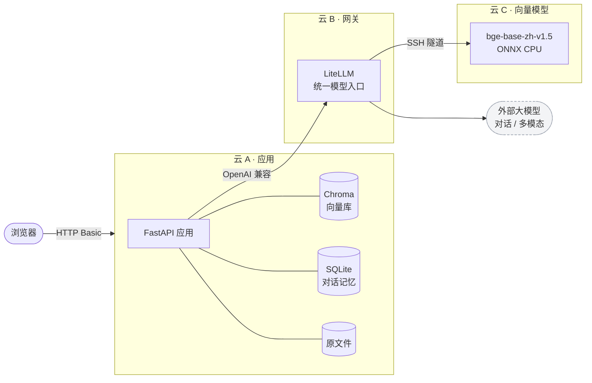

# 架构说明

## 部署拓扑

三台 2 核小规格云主机，按职责拆分。云 A 与云 C 之间网络不通，
所有跨区流量经由云 B 中转。



## 为什么这样拆

| 决策 | 原因 |
|---|---|
| 向量模型独立一台 | 模型常驻约 800 MB，应用机只有 2 GB，放一起会互相挤占 |
| 所有模型调用走 LiteLLM | 换模型、换供应商只改网关配置，应用代码不动 |
| 跨主机走 SSH 隧道 | 向量服务只监听 `127.0.0.1`，不暴露公网；密钥限制为仅允许单端口转发 |
| 向量库和原文件留在应用机 | 文档和索引不出自己的服务器，只有待识别图片和检索片段会发给模型 |

## 问答链路

```
提问
 └─ 问题改写      多轮时补全指代，首轮直接跳过
 └─ 向量化        云 A → 云 B → 云 C
 └─ 向量检索      Chroma 取 TOP_K，过滤低分片段
 └─ 生成回答      系统提示 + 历史 + 片段，流式返回
 └─ 写入记忆      答案与引用一起存库
```

每一步都是 LangSmith 里的一个节点，耗时自动拆分。

## 组织运行图谱（graph.db）

文档 → SOP → 工具 原本是一条单向流，工具查到的真实数据和人对一次回答的判断答完就丢。
图谱把它们留下来，SOP 和文档从「源头」变成图谱的「生成物」；模块在 `app/graph.py`，
一个 SQLite 文件、六张表，不引入图数据库：

| 表 | 存什么 |
|---|---|
| `executions` | 一次提问 / 一次「▶ 执行」：会话、对应的回答消息、按哪个 SOP 跑的、结论质量（ok / anomaly / failed / unknown） |
| `tool_calls` | 每次工具调用的参数、**完整返回**（页面和模型看到的都是截断 / 压缩过的）、成功与否、耗时 |
| `entities` | 容器、命名空间、K8s 对象、工具、SOP、文档、阈值、执行……`(kind, name)` 唯一，记首次 / 最近见到的时间 |
| `facts` | 主语 → 谓语 → 宾语（实体或字面量），带 `source_kind`（tool / doc / human / sop）和 `source_ref`（`tool_call:<id>` / `sop:<id>` / `feedback:<id>`） |
| `proposals` | 图谱提出的建议（长出 SOP、补充 SOP、调阈值……），`evidence_refs` 指向工具调用，状态 pending / approved / rejected |
| `feedback` | 人对一次执行的判断：correct / false_alarm / wrong_threshold / missing_step |

两条铁律：**没有出处的事实、没有证据的提议不进图谱**（Python 层校验 + 表上 CHECK）；
**事实只追加不覆盖**，同一主语同一谓语的多条记录就是时间线，撤回只把状态改成 retracted。

第一期不用模型抽实体，只在三处零成本播种：

```
保存 SOP      sop —checks→ tool；sop —defined_in→ doc；检查点里可靠解析出的「80%」「3 次」→ threshold 实体
调用工具      execution —called→ tool；调用成功时，pattern 为 name / k8s_name 的实参成为实体并刷新 last_seen
人工反馈      execution —judged→ verdict（按 SOP 执行的，SOP 也记一笔）
```

工具调用在 `loop.py` 的 `tools` 节点里落盘（`run(..., execution_id=)`），对外事件仍只发预览，
前端协议不变；`/api/ask` 首行多一个 `execution_id`，`POST /api/feedback` 用它打反馈。

## 入库链路

```
上传文件
 └─ 解析          PDF / DOCX / PPTX / 图片 / 文本
 └─ 图片识别      抽出内嵌图片 → 多模态模型 → 结果插回原位
 └─ 自动分类      模型给出简短分类，可手工覆盖
 └─ 切分          约 400 字，重叠 50 字
 └─ 向量化入库    文本 + 向量 + 来源页码一起写入 Chroma
```

## 关键取舍

**手写解析器，而不是用现成 Loader。** 标准加载器会丢掉内嵌图片、演讲者备注、
组合图形和表格顺序——这些恰恰是真实笔记里信息密度最高的部分。
代价是解析代码需要自己维护。

**片段 ID 按文件名生成，不按内容哈希。** 否则两个内容相同、文件名不同的文档
会互相覆盖，先传的那份会静默消失。

**不默认下发 `reasoning_effort`。** 部分网关对该参数的处理是把思考内容并入正文，
反而污染回答。只在确认模型支持时才开启。

**对话记忆用 SQLite 而非 LangGraph Checkpointer。** 只需要存消息本身，
不需要图状态；少一层依赖，在小内存机器上更省。
